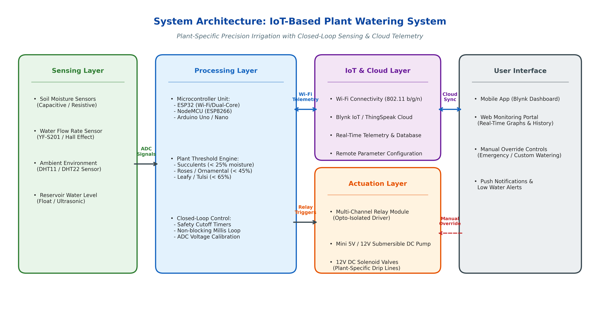
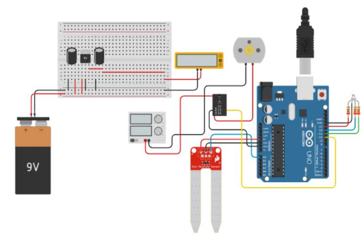
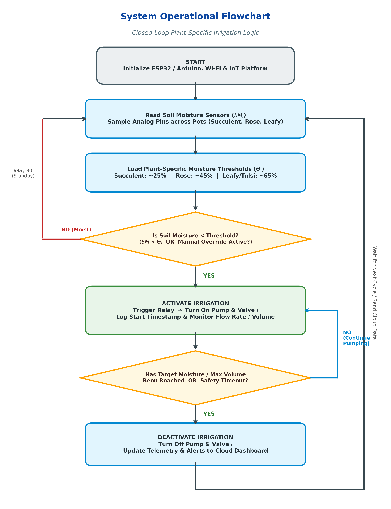

# An IoT-Based Plant Watering System for Controlled Irrigation Based on Plant-Specific Requirements

[](https://opensource.org/licenses/MIT)
[](https://www.espressif.com/)
[](https://blynk.io/)
[](CITATION.cff)
[](research_paper.pdf)

An intelligent, closed-loop precision irrigation system developed with the Internet of Things (IoT) that delivers customized water volumes according to distinct physiological plant requirements (e.g., succulents, ornamental roses, and leafy vegetables), eliminating water waste and preventing over/under-watering stresses.

---

## 👥 Authors & Affiliation

* **Ayush Kumar Jha** ([jhaayush628@gmail.com](mailto:jhaayush628@gmail.com))
* **Saif Ahmed** ([saifamd65@gmail.com](mailto:saifamd65@gmail.com))
* **Dev Dharra** ([Umedsingh9718@gmail.com](mailto:Umedsingh9718@gmail.com))
* **Ankur Dhankher** ([ankurdhankher123@gmail.com](mailto:ankurdhankher123@gmail.com))
* **Tanvi Gupta** ([tanvigupta.set@mriu.edu.in](mailto:tanvigupta.set@mriu.edu.in))

*Department of Computer Science and Engineering, Manav Rachna International Institute of Research and Studies (MRIIRS), Faridabad, Haryana, India.*

---

## 📌 Abstract

Water shortage and low-efficiency irrigation are major global challenges, with approximately two-thirds of freshwater consumed by agriculture. Conventional irrigation methods (flooding, uniform sprinklers, or scheduled manual watering) supply the same volume of water indiscriminately across different plant species regardless of their physiological needs. As a consequence, drought-resistant varieties suffer from root rot due to waterlogging, while moisture-sensitive plants experience drought stress.

This project introduces an IoT-based, plant-specific smart irrigation framework. Using soil moisture sensors placed at individual plant root zones, an ESP32/Arduino microcontroller compares real-time moisture levels against calibrated, plant-specific setpoints. When soil moisture drops below the threshold, multi-channel relays trigger a submersible DC pump and individual solenoid valves to supply the tailored amount of water until optimal saturation is achieved. Real-time telemetry, historical consumption graphs, and remote manual override controls are synchronized to an IoT cloud platform (Blynk / ThingSpeak).

---

## 🏗️ System Architecture

The architecture comprises four coordinated layers:
1. **Sensing Layer:** Multi-channel capacitive/resistive soil moisture probes, water flow rate sensor (YF-S201), ambient DHT sensors, and reservoir level indicators.
2. **Processing Layer:** Microcontroller (ESP32 / NodeMCU / Arduino Uno) running closed-loop threshold logic, safety timeout routines, and ADC calibration.
3. **Actuation Layer:** Opto-isolated relay modules driving a master DC submersible water pump and independent solenoid valves per plant bed.
4. **IoT & Cloud Layer:** Wi-Fi telemetry over MQTT/HTTP to cloud dashboards (Blynk / ThingSpeak) enabling real-time monitoring and mobile alerts.



---

## 🔌 Hardware Circuit & Pinout

The physical prototype integrates low-cost, readily available hardware components:



### Pin Configuration Table

| Component | ESP32 Pin | Arduino Uno Pin | Description |
| :--- | :--- | :--- | :--- |
| **Soil Sensor 1 (Succulent)** | GPIO 34 (ADC1_CH6) | A0 | Analog moisture voltage probe for low-water plants |
| **Soil Sensor 2 (Ornamental)**| GPIO 35 (ADC1_CH7) | A1 | Analog moisture voltage probe for rose/ornamentals |
| **Soil Sensor 3 (Leafy)**     | GPIO 32 (ADC1_CH4) | A2 | Analog moisture voltage probe for tulsi/vegetables |
| **Relay: Master Water Pump**  | GPIO 25 | Pin 7 | Controls 5V/12V DC submersible water pump |
| **Relay: Solenoid Valve 1**   | GPIO 26 | Pin 6 | Plant 1 irrigation line shutoff |
| **Relay: Solenoid Valve 2**   | GPIO 27 | Pin 5 | Plant 2 irrigation line shutoff |
| **Relay: Solenoid Valve 3**   | GPIO 14 | Pin 4 | Plant 3 irrigation line shutoff |
| **Flow Rate Sensor (Pulse)**  | GPIO 4 | Pin 3 (INT1) | Hall-effect water volume counter |
| **Manual Override Button**    | GPIO 13 | Pin 2 (INT0) | Local tactile push button (active LOW) |
| **Status Indicator LED**      | GPIO 2 | Pin 13 | Active watering / system heart-beat |

---

## 🔄 Operational Flowchart & Working Principle

The firmware follows a robust closed-loop control sequence:



1. **Initialization:** Microcontroller configures GPIO directions, ADC resolution, connects to Wi-Fi, and binds with the IoT Cloud platform.
2. **Sensor Sampling:** Analog soil moisture values are continuously read and filtered via multi-sample averaging.
3. **Threshold Evaluation:** Current moisture $SM_i$ is compared with the plant category setpoint $\Theta_i$:
   * **Succulent (Aloe Vera):** $\Theta = 25\%$ (Target: $35\%$)
   * **Ornamental (Rose):** $\Theta = 45\%$ (Target: $55\%$)
   * **Leafy Plant (Tulsi):** $\Theta = 65\%$ (Target: $75\%$)
4. **Precision Actuation:** If $SM_i < \Theta_i$, the corresponding solenoid valve and master pump are energized.
5. **Safety Timeout:** Irrigation stops when either the target moisture is reached or the maximum allowable dose timer expires (preventing reservoir flooding or line bursts).
6. **Telemetry & Cloud Sync:** Soil moisture levels, watering state, and total liters delivered are streamed to the mobile dashboard.

---

## 📊 Experimental Results

Experimental evaluation across a 30-day testing cycle demonstrated:
* **Soil Moisture Stability:** The closed-loop IoT controller maintained moisture consistently within optimal ranges ($\pm 5\%$), eliminating the severe over-saturation and drought cycles observed with manual watering.
* **Water Conservation:**
  * **Succulents:** $\approx 48\%$ reduction in water usage compared to manual methods.
  * **Ornamentals (Rose):** $\approx 42\%$ reduction in water usage.
  * **Leafy Vegetables (Tulsi):** Water consumption decreased from **18 Liters/week** (manual) down to **10 Liters/week** (IoT-controlled) — a **44.4% net water saving**.

---

## 📁 Repository Structure

```plaintext
├── CITATION.cff             # Academic software citation metadata
├── LICENSE                  # MIT open-source license
├── README.md                # Comprehensive project documentation
├── circuit_diagram.png      # Hardware wiring and prototype pin connections
├── flowchart.png            # Operational firmware flowchart
├── main.ino                 # Production Arduino/ESP32 firmware code
├── research_paper.pdf       # Full research paper PDF
└── system_architecture.png  # Layered system architecture diagram
```

---

## 🚀 Getting Started

### 1. Prerequisites
* [Arduino IDE](https://www.arduino.cc/en/software) (version 2.0 or higher recommended)
* ESP32 Board Package installed via Arduino Board Manager (`https://raw.githubusercontent.com/espressif/arduino-esp32/gh-pages/package_esp32_index.json`)
* Required Libraries:
  * `Blynk` (by Volodymyr Shymanskyy)
  * `WiFi` (Built-in with ESP32/ESP8266 core)

### 2. Hardware Assembly
1. Connect the analog signal pins of each capacitive soil moisture sensor to the designated ADC pins.
2. Wire the opto-isolated 4-channel relay module to a 5V/12V external power supply with a common ground to the microcontroller.
3. Plumb the water pump output through the flow sensor into the solenoid valve manifold, routing individual drip lines to each pot.

### 3. Firmware Flashing
1. Open `main.ino` in the Arduino IDE.
2. Configure your Wi-Fi credentials:
   ```cpp
   const char* ssid     = "YOUR_WIFI_SSID";
   const char* password = "YOUR_WIFI_PASSWORD";
   ```
3. Insert your Blynk Template ID and Auth Token:
   ```cpp
   #define BLYNK_TEMPLATE_ID   "YOUR_TEMPLATE_ID"
   #define BLYNK_AUTH_TOKEN    "YOUR_AUTH_TOKEN"
   ```
4. Select board **ESP32 Dev Module** (or **Arduino Uno**), choose the correct COM port, and click **Upload**.

---

## 📜 Citation

If you use this project, code, or research methodology, please cite our paper:

```bibtex
@article{jha2026iotirrigation,
  title={An IoT-Based Plant Watering System for Controlled Irrigation Based on Plant-Specific Requirements},
  author={Jha, Ayush Kumar and Ahmed, Saif and Dharra, Dev and Dhankher, Ankur and Gupta, Tanvi},
  journal={Department of Computer Science and Engineering, MRIIRS},
  year={2026}
}
```

---

## 📄 License

This repository is distributed under the **MIT License**. See [LICENSE](LICENSE) for more details.
